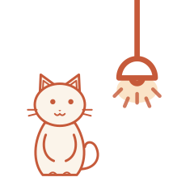

<h1 align="center">Neuro-Mentum</h1>

<b>A quiet desk lamp for your Mac: focus in rounds, recover between them, and keep a private journal.</b>

<a href="https://github.com/lingegrace/neuro-mentum/releases/latest"><b>Download for Mac</b></a> · macOS 11+ · Apple silicon and Intel · Free

---

Deep work tires the part of the brain that does the focusing, the prefrontal cortex. Most focus timers only tell you when to stop. Neuro-Mentum also tells you **how to rest**, with short recovery actions chosen for how you feel, so the next round starts fresh.

It lives in your menu bar as a small lamp and stays out of the way while you work.

## What it does

- **Focus rounds.** Start a round from the lamp. A small timer floats beside your work, and the lamp warms up when five minutes are left. A round ends with one soft chime.
- **Recovery breaks.** After each round, tell it how you feel: tired, anxious or foggy. It suggests a short recovery action, such as breathing, a short walk or resting your eyes. Each action shows how strong the research behind it is.
- **Breathing before you start.** Box, 4-7-8 and other patterns, counted in breaths.
- **Quick capture.** Press **⌥ Space** to jot down a to-do without leaving what you're doing. Press **⌥ J** to write in your journal.
- **A weekly review.** See your rounds, finished to-dos and journal for the week, and export them as a Word document.
- **Looks you can change.** Soft colour skins, and paper, solid and night modes.

## Your data stays on your Mac

Your journal, to-dos and rounds are saved only on your computer:
`~/Library/Application Support/Neuro-Mentum/`. Nothing is uploaded, and there is no account to create.

## Install

1. [Download the latest `.dmg`](https://github.com/lingegrace/neuro-mentum/releases/latest).
2. Open it and drag **Neuro-Mentum** into **Applications**.
3. Open Neuro-Mentum. A small lamp appears at the top right of your screen.

**If macOS says it can't check the app:** Neuro-Mentum isn't yet registered with Apple, so the first launch needs one extra step. Go to **System Settings → Privacy & Security**, scroll down and click **Open Anyway**. You only need to do this once.

## Feedback

Made by [Linge (Grace) Guo](https://lingegrace.github.io/work-from-home-/). Ideas and bug reports are welcome in [Issues](https://github.com/lingegrace/neuro-mentum/issues).
